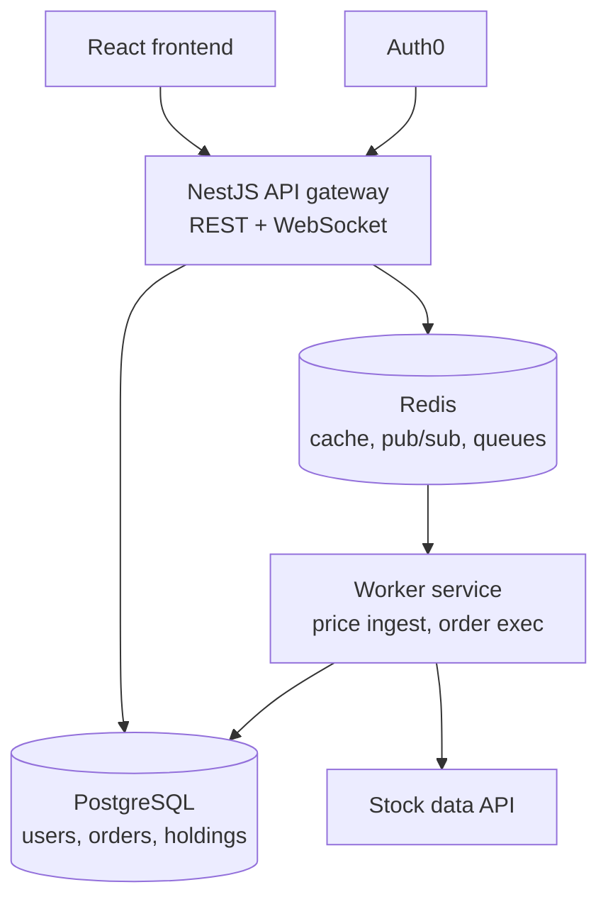
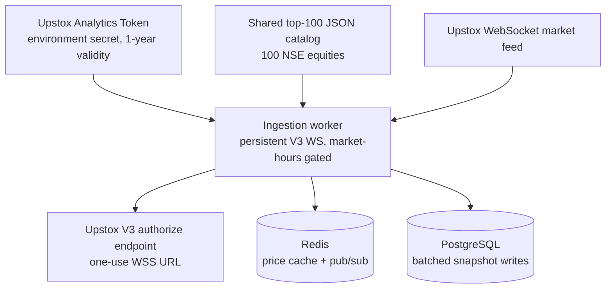
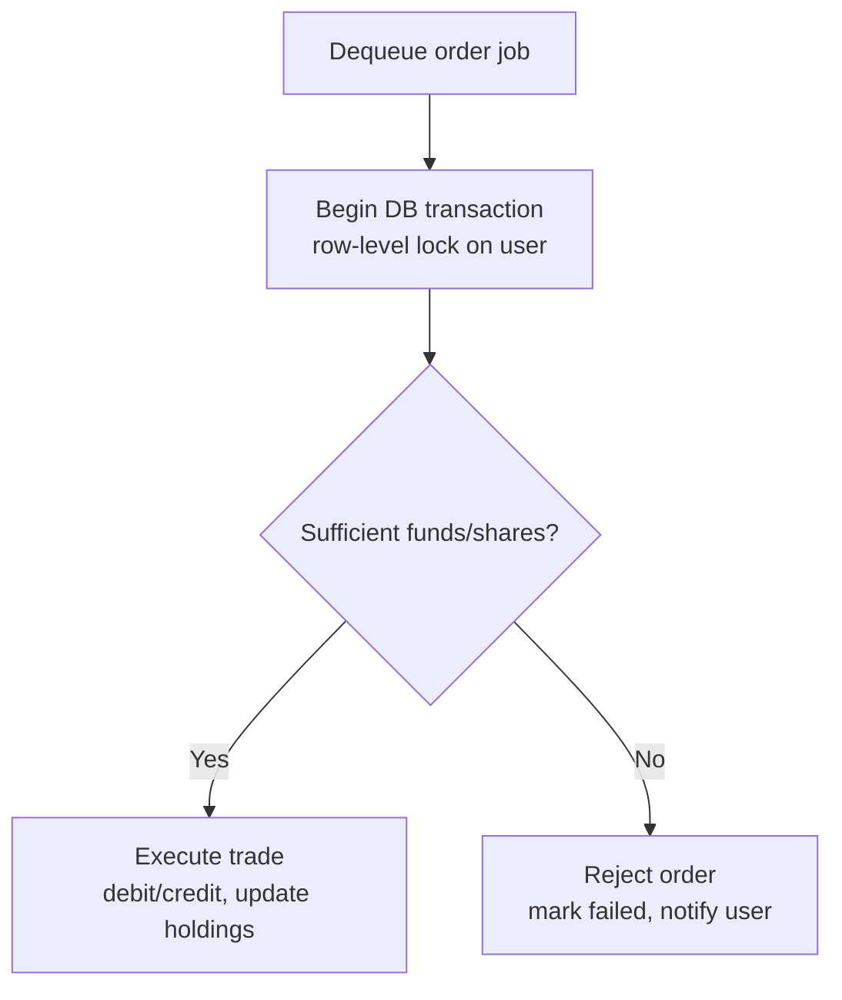

# Architecture

## System overview



## Price ingestion pipeline (push-based, via Upstox)



Notes:

- No polling on the normal path. The worker holds one persistent Market Data
  Feed V3 connection and subscribes in LTPC mode to the 100 unique NSE equity
  instrument keys from `libs/common/src/data/nse-top-100.json` (relocated from
  the validated root input file during Phase 6).
- The read-only Upstox Analytics Token is supplied as
  `UPSTOX_ANALYTICS_TOKEN` and is valid for one year. No API key/secret, TOTP,
  daily login automation, or token-in-Redis job is part of this design.
- Each connection or reconnect calls the V3 authorize endpoint to obtain a
  fresh single-use `authorized_redirect_uri`; that WSS URL is never persisted.
- Before connecting, the worker queries Upstox's date-specific market-timings
  endpoint and uses the returned NSE session. A missing NSE session means the
  market is closed, so weekends, trading holidays, and special sessions do not
  depend on a hardcoded calendar. If the calendar request fails, ingestion
  stays disconnected and retries rather than guessing that the market is open.
- Outside a session the WebSocket stays off, but the worker makes one batched
  LTP REST request for the 100 keys per closed period (at startup and again
  after each session ends; a failed attempt retries on the next closed-market
  poll). Upstox returns the last traded (closing) price, which goes through
  the normal tick path into Redis, pub/sub, and `PriceSnapshot`, so the site
  shows closing prices overnight, on weekends, and on holidays. Its `ts` is
  the fetch time; the LTP response carries no trade timestamp.
- The API loads the same 100-entry catalog for local search and pagination.
  User searches never call Upstox, so they consume no provider rate limit.
- **Latency-sensitive vs. throughput-sensitive paths are intentionally split**:
  every tick updates the Redis cache and publishes to pub/sub synchronously
  (this is what makes the frontend feel real-time), but Postgres writes are
  deduplicated to the latest tick per symbol and flushed in small batches every
  few seconds — writing every tick individually would be unnecessary DB load.
- If the WebSocket can't reconnect after several attempts, fall back
  temporarily to one batched LTP request covering the 100 keys, with
  rate-limited polling and an alert, rather than going silent on prices.
- This use of the Upstox API is scoped to personal/portfolio-project use
  under one developer account, not a licensed multi-tenant redistribution
  product — keep it framed that way in anything public-facing about this
  project.

## Market data read path

`MarketService` normalizes symbols to uppercase and reads `price:{symbol}`
from Redis first. A miss or malformed/unavailable cache entry falls back to
the latest matching `PriceSnapshot` in Postgres, then best-effort repopulates
Redis. Cache outages therefore degrade to database reads instead of taking
the market endpoint down.

Prices remain `BigInt` paise inside the service. Redis JSON and HTTP response
DTOs encode `priceCents` as a base-10 string because JSON cannot represent
`BigInt` and converting to a JavaScript number could lose precision. The
top-100 catalog contains equities only, so `GET /indices` remains empty until
index instruments are deliberately added as a separate catalog.

## Portfolio read path

`GET /portfolio` uses the authenticated JWT `sub` to find the corresponding
`User.auth0Id`. Active holdings (`quantity > 0`) are joined with current
prices through `MarketService`. For each holding:

- market value = current price × quantity
- cost basis = persisted exact aggregate holding basis
- unrealized P&L = market value − cost basis

All three calculations and portfolio totals use `BigInt` paise. HTTP DTOs
serialize the resulting money fields as exact decimal strings. Quantity-zero
holdings are omitted and do not trigger price lookups; Phase 5 order execution
is responsible for maintaining each holding's exact basis and display average.

## Order execution flow



Key correctness rules (do not weaken these without discussion):

1. Order jobs for the **same user** must be processed sequentially, not in
   parallel. The BullMQ OSS worker currently enforces the stronger global
   concurrency limit of 1; raising concurrency requires a per-user sequencing
   mechanism (BullMQ Pro groups or a distributed per-user lock).
2. All balance/holding reads and writes for a single order happen inside
   **one Postgres transaction** with a row-level lock (`SELECT ... FOR UPDATE`
   or Prisma `SERIALIZABLE` isolation).
3. Orders carry an idempotency check — reprocessing an already-`filled` or
   already-`rejected` order is a no-op.
4. Redis events (order-filled, price-tick) are published **after** the DB
   transaction commits, never before.

The API validates and durably stores a `PENDING` order, then best-effort
enqueues only its `orderId` and `userId`; it never checks balances. A worker
reconciliation loop periodically re-enqueues every `PENDING` row using the
order id as BullMQ's deterministic job id, so a Redis outage between the
database write and enqueue cannot strand or duplicate an order.

The worker locks the user row with the one intentional raw query
(`SELECT ... FOR UPDATE`) because Prisma has no row-lock API. Price lookup,
funds/shares checks, balance and holding mutations, final order status, and
ledger insertion all occur inside that transaction. Filled/rejected events
are string-safe JSON published after commit. `eventPublishedAt` and the
persisted rejection reason allow a failed publication to retry without
reapplying the trade; delivery is at-least-once. Jobs retry with exponential
backoff and move to a separate dead-letter queue with an alert after exhausting
attempts.

Buy execution keeps both `Holding.costBasisCents` (the exact aggregate basis)
and `avgCostCents` (the integer-paise display average). New buys add their exact
trade value to the basis, avoiding compounded rounding loss. Sells remove a
proportional basis, allocating any sub-paise division remainder to the shares
still held. A fully sold position retains zero quantity, basis, and average.

## Data model

Defined in `libs/db/prisma/schema.prisma`. All money fields are `BigInt`
storing integer paise — never a float, never a JS `number` in a calculation.
Display-only conversion helpers live in `libs/common` (`paiseToDisplayRupees`).

| Model | Purpose | Key fields |
|---|---|---|
| `User` | One trading account per person, opened by `POST /me` | `cashBalanceCents` (BigInt), unique `auth0Id` (Auth0 identity) and unique lowercase `email` |
| `Holding` | Current position per user+symbol | `quantity`, exact `costBasisCents`, display `avgCostCents`; unique on `(userId, symbol)` |
| `Order` | A buy/sell request and its outcome | `side` (BUY/SELL), `status` (PENDING/FILLED/REJECTED), `fillPriceCents` (set only on execution), rejection/event-delivery metadata |
| `Transaction` | Append-only ledger entry | `amountCents` (signed: negative = debit, positive = credit), optionally linked to an `Order` |
| `PriceSnapshot` | Time-series of prices | `symbol`, `priceCents`, `ts`; indexed on `(symbol, ts)` |

`Order` and `Transaction` are deliberately separate: `Order` is "what was
requested and its current state," `Transaction` is "what actually happened to
the ledger." This split is what makes it possible to have an `Order` sitting
`PENDING` in the queue with zero effect on the user's balance until the
worker commits it.

## Repository layout

```
tradesim/
  AGENTS.md, CLAUDE.md, .cursor/rules/, .github/copilot-instructions.md
  docs/{ARCHITECTURE,DECISIONS,TASKS}.md
  docker-compose.yml            # Postgres, Redis, Adminer
  apps/
    api/                        # NestJS — HTTP + WebSocket gateway
      src/
        health/                 # Phase 1
        auth/                   # Phase 2
        accounts/               # POST /me — account provisioning
        redis/                  # Phase 3
        market/                 # Phase 3
        portfolio/              # Phase 4
        orders/                 # Phase 5
        realtime/               # Phase 7
        ai/                     # Phase 8
    worker/                     # Long-running processes, no HTTP server
      src/
        execution/               # Phase 5 — order-execution BullMQ consumer
        ingestion/                # Phase 6 — Upstox WebSocket ingestion
    web/                        # Frontend track — Vite + React SPA
      src/
        api/                     # wire types, HTTP client, mock API, queries
        auth/                    # Auth0 / mock auth behind one context
        components/, pages/, lib/, styles/
  libs/
    db/                          # Prisma schema + client, shared by both apps
    common/                      # Shared wire types (PriceTick) and money helpers
  infra/auth0/                   # Auth0 Action source, installed by hand
```

Folders not yet created (`auth/`, `market/`, `portfolio/`, `orders/`,
`realtime/`, `ai/`, `execution/`, `ingestion/`) are exactly the module names
each phase in `docs/TASKS.md` creates — the layout above is the target shape
of the whole repo, not just what exists today.

## Frontend (`apps/web`)

A Vite + React SPA that talks only to the existing HTTP API. Auth0's SPA SDK
obtains an access token for `AUTH0_AUDIENCE` and every request sends it as a
bearer token. In development Vite proxies `/api/*` to the API (which does not
enable CORS); a production deployment needs either the same reverse-proxy
arrangement or CORS added to the API.

- Money: API decimal-string paise are parsed straight to `BigInt`; estimates,
  totals, and P&L percentages are BigInt arithmetic, formatted with
  `paiseToDisplayRupees` plus Indian digit grouping. Chart pixel coordinates
  are the only place a price becomes a JS number.
- Prices: React Query polls `GET /stocks/:symbol` every 5 s and the portfolio
  every 10 s until the Phase 7 WebSocket gateway exists. Observed prices are
  kept in an in-memory per-symbol history that drives the session chart and
  session high/low (there is no price-history endpoint).
- Orders: the ticket mirrors `CreateOrderDto` validation, posts, and treats
  the 202 as "queued". Without an order-history endpoint, submitted orders are
  remembered in `localStorage` per Auth0 subject, and the portfolio is
  re-fetched a few times as the worker settles.
- Mock mode (`VITE_API_MODE=mock`) swaps in an in-browser implementation of
  the same `TradeSimApi` interface plus a fake signed-in user; it settles
  orders with the worker's BigInt rules so the UI can be exercised end to end.

## Account provisioning (`apps/api/src/accounts`)

A trading account is a `users` row keyed by the Auth0 subject (`auth0Id`)
and an email; both columns are unique, so each login owns at most one
account and each email backs at most one account. Every Auth0 login method
yields its own `sub` (`google-oauth2|…`, `auth0|…`), so the email is what
stops one person from holding two wallets.

```mermaid
sequenceDiagram
  participant W as apps/web
  participant A as POST /me
  participant I as Auth0 /userinfo
  participant P as Postgres
  W->>A: Bearer access token (after login)
  A->>P: user by auth0Id
  alt account exists
    A-->>W: 200 account
  else first sign-in
    A->>I: same bearer token
    I-->>A: sub, email, email_verified
    A->>A: sub matches token? email present and verified?
    A->>P: user by email
    alt email owned by another login
      A-->>W: 409 EMAIL_IN_USE (names that method)
    else
      A->>P: BEGIN; INSERT user (₹1,00,000); INSERT DEPOSIT; COMMIT
      A-->>W: 201 account (created: true)
    end
  end
```

- Concurrent first requests race on the unique constraints; losers re-read
  and return the winner's account, or 409 if a different login took the
  email.
- Unverified emails are refused (403 `EMAIL_NOT_VERIFIED`) so nobody can
  reserve someone else's address with an unconfirmed password sign-up.
- Auth0 side: a Pre User Registration Action
  (`infra/auth0/pre-user-registration-block-duplicate-email.js`) refuses an
  email/password sign-up whose email already exists in the tenant, so the
  user is told on the sign-up form. The API check is authoritative and also
  covers Google-after-password, which that trigger never sees.

## Module structure (`apps/api`)

- **Core (global)**: `ConfigModule`, `PrismaModule`, `RedisModule`,
  `AuthModule`.
- **Feature**: `AccountsModule` (`POST /me` provisioning),
  `MarketModule` (read-only), `PortfolioModule` (read-only),
  `OrdersModule` (validates + enqueues, never executes inline),
  `RealtimeModule` (WebSocket gateway, subscribes to Redis).


