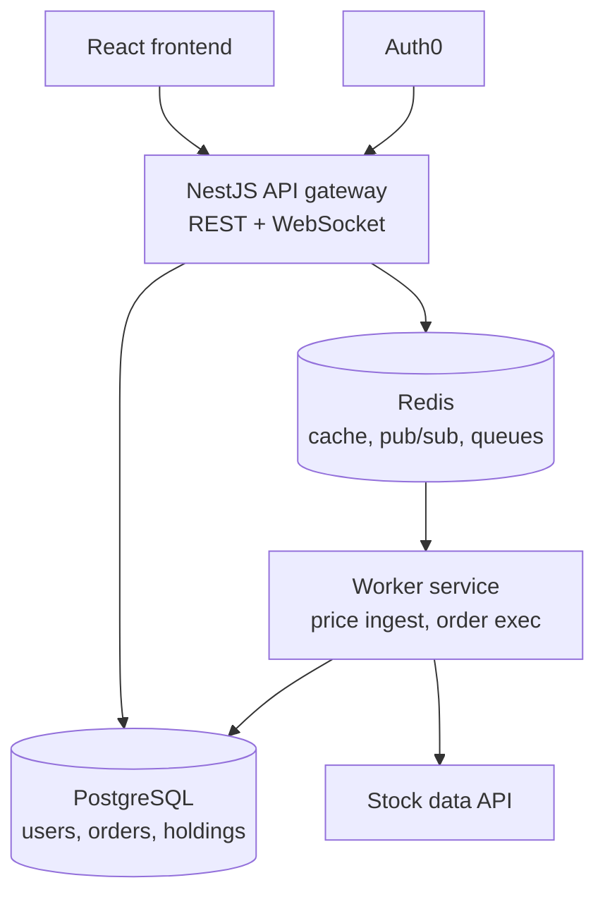
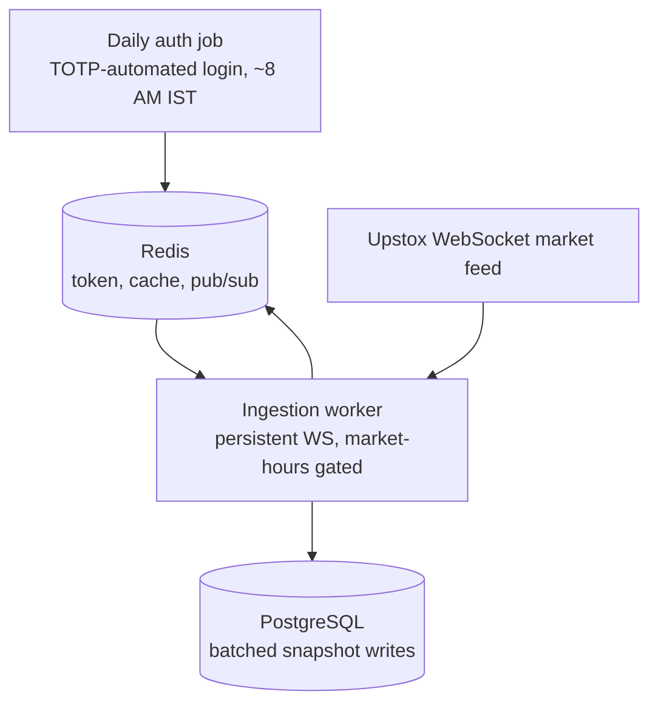
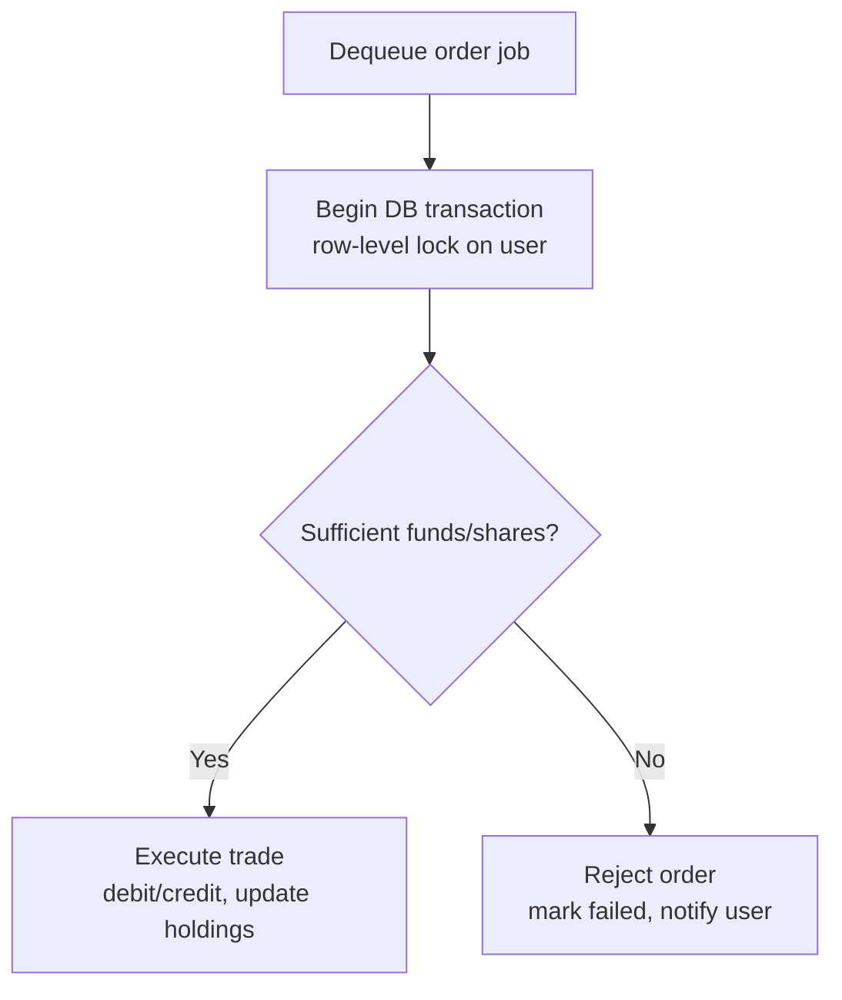

# Architecture

## System overview



## Price ingestion pipeline (push-based, via Upstox)



Notes:

- No polling. The worker holds one persistent WebSocket connection and
  subscribes to a curated list of ~20-30 instrument keys (Nifty 50 names +
  a couple of indices), not the full NSE/BSE universe.
- Upstox access tokens expire daily (~3:30 AM IST) with no long-lived refresh
  token on the free tier, so a separate daily auth job automates login via
  TOTP and writes the token to Redis before market open.
- **Latency-sensitive vs. throughput-sensitive paths are intentionally split**:
  every tick updates the Redis cache and publishes to pub/sub synchronously
  (this is what makes the frontend feel real-time), but Postgres writes are
  buffered and flushed in small batches every few seconds — writing every
  single tick to Postgres individually would be unnecessary DB load.
- If the WebSocket can't reconnect after several attempts, fall back
  temporarily to REST polling of the LTP endpoint and raise an alert, rather
  than going silent on prices.
- This use of the Upstox API is scoped to personal/portfolio-project use
  under one developer account, not a licensed multi-tenant redistribution
  product — keep it framed that way in anything public-facing about this
  project.

## Market data read path

`MarketService` normalizes symbols to uppercase and reads `price:{symbol}`
from Redis first. A miss or malformed/unavailable cache entry falls back to
the latest matching `PriceSnapshot` in Postgres, then best-effort repopulates
Redis. Cache outages therefore degrade to database reads instead of taking
the market endpoint down.

Prices remain `BigInt` paise inside the service. Redis JSON and HTTP response
DTOs encode `priceCents` as a base-10 string because JSON cannot represent
`BigInt` and converting to a JavaScript number could lose precision. The
placeholder `CURATED_INDEX_SYMBOLS` list is intentionally empty until the
real Upstox instrument selection is completed, so `GET /indices` currently
returns an empty list.

## Portfolio read path

`GET /portfolio` uses the authenticated JWT `sub` to find the corresponding
`User.auth0Id`. Active holdings (`quantity > 0`) are joined with current
prices through `MarketService`. For each holding:

- market value = current price × quantity
- cost basis = persisted exact aggregate holding basis
- unrealized P&L = market value − cost basis

All three calculations and portfolio totals use `BigInt` paise. HTTP DTOs
serialize the resulting money fields as exact decimal strings. Quantity-zero
holdings are omitted and do not trigger price lookups; Phase 5 order execution
is responsible for maintaining each holding's exact basis and display average.

## Order execution flow



Key correctness rules (do not weaken these without discussion):

1. Order jobs for the **same user** must be processed sequentially, not in
   parallel. The BullMQ OSS worker currently enforces the stronger global
   concurrency limit of 1; raising concurrency requires a per-user sequencing
   mechanism (BullMQ Pro groups or a distributed per-user lock).
2. All balance/holding reads and writes for a single order happen inside
   **one Postgres transaction** with a row-level lock (`SELECT ... FOR UPDATE`
   or Prisma `SERIALIZABLE` isolation).
3. Orders carry an idempotency check — reprocessing an already-`filled` or
   already-`rejected` order is a no-op.
4. Redis events (order-filled, price-tick) are published **after** the DB
   transaction commits, never before.

The API validates and durably stores a `PENDING` order, then best-effort
enqueues only its `orderId` and `userId`; it never checks balances. A worker
reconciliation loop periodically re-enqueues every `PENDING` row using the
order id as BullMQ's deterministic job id, so a Redis outage between the
database write and enqueue cannot strand or duplicate an order.

The worker locks the user row with the one intentional raw query
(`SELECT ... FOR UPDATE`) because Prisma has no row-lock API. Price lookup,
funds/shares checks, balance and holding mutations, final order status, and
ledger insertion all occur inside that transaction. Filled/rejected events
are string-safe JSON published after commit. `eventPublishedAt` and the
persisted rejection reason allow a failed publication to retry without
reapplying the trade; delivery is at-least-once. Jobs retry with exponential
backoff and move to a separate dead-letter queue with an alert after exhausting
attempts.

Buy execution keeps both `Holding.costBasisCents` (the exact aggregate basis)
and `avgCostCents` (the integer-paise display average). New buys add their exact
trade value to the basis, avoiding compounded rounding loss. Sells remove a
proportional basis, allocating any sub-paise division remainder to the shares
still held. A fully sold position retains zero quantity, basis, and average.

## Data model

Defined in `libs/db/prisma/schema.prisma`. All money fields are `BigInt`
storing integer paise — never a float, never a JS `number` in a calculation.
Display-only conversion helpers live in `libs/common` (`paiseToDisplayRupees`).

| Model | Purpose | Key fields |
|---|---|---|
| `User` | One row per trader | `cashBalanceCents` (BigInt), `auth0Id` (links to Auth0 identity) |
| `Holding` | Current position per user+symbol | `quantity`, exact `costBasisCents`, display `avgCostCents`; unique on `(userId, symbol)` |
| `Order` | A buy/sell request and its outcome | `side` (BUY/SELL), `status` (PENDING/FILLED/REJECTED), `fillPriceCents` (set only on execution), rejection/event-delivery metadata |
| `Transaction` | Append-only ledger entry | `amountCents` (signed: negative = debit, positive = credit), optionally linked to an `Order` |
| `PriceSnapshot` | Time-series of prices | `symbol`, `priceCents`, `ts`; indexed on `(symbol, ts)` |

`Order` and `Transaction` are deliberately separate: `Order` is "what was
requested and its current state," `Transaction` is "what actually happened to
the ledger." This split is what makes it possible to have an `Order` sitting
`PENDING` in the queue with zero effect on the user's balance until the
worker commits it.

## Repository layout

```
tradesim/
  AGENTS.md, CLAUDE.md, .cursor/rules/, .github/copilot-instructions.md
  docs/{ARCHITECTURE,DECISIONS,TASKS}.md
  docker-compose.yml            # Postgres, Redis, Adminer
  apps/
    api/                        # NestJS — HTTP + WebSocket gateway
      src/
        health/                 # Phase 1
        auth/                   # Phase 2
        redis/                  # Phase 3
        market/                 # Phase 3
        portfolio/              # Phase 4
        orders/                 # Phase 5
        realtime/               # Phase 7
        ai/                     # Phase 8
    worker/                     # Long-running processes, no HTTP server
      src/
        execution/               # Phase 5 — order-execution BullMQ consumer
        ingestion/                # Phase 6 — Upstox WebSocket ingestion
  libs/
    db/                          # Prisma schema + client, shared by both apps
    common/                      # Shared wire types (PriceTick) and money helpers
```

Folders not yet created (`auth/`, `market/`, `portfolio/`, `orders/`,
`realtime/`, `ai/`, `execution/`, `ingestion/`) are exactly the module names
each phase in `docs/TASKS.md` creates — the layout above is the target shape
of the whole repo, not just what exists today.

## Module structure (`apps/api`)

- **Core (global)**: `ConfigModule`, `PrismaModule`, `RedisModule`,
  `AuthModule`.
- **Feature**: `MarketModule` (read-only), `PortfolioModule` (read-only),
  `OrdersModule` (validates + enqueues, never executes inline),
  `RealtimeModule` (WebSocket gateway, subscribes to Redis).


